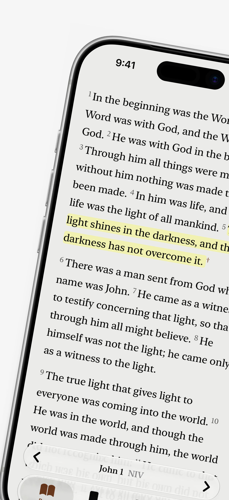
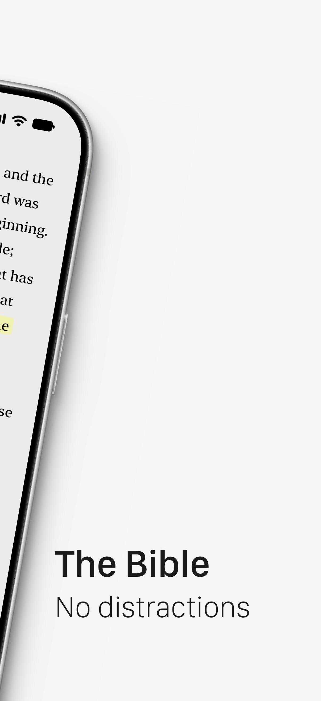
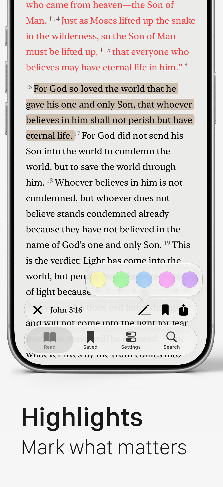
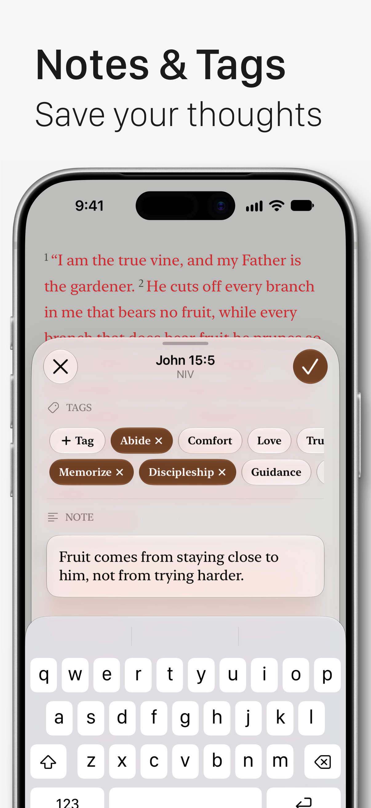
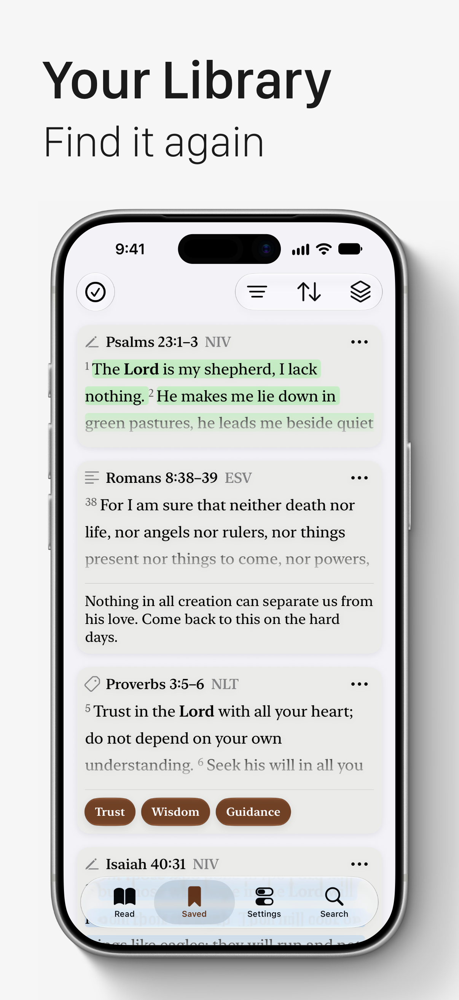
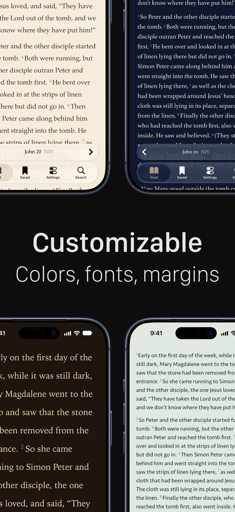

  <a href="https://github.com/brandonkthomas/SwiftBible">
    <picture>
      <source media="(prefers-color-scheme: dark)" srcset="Public/AppIcon/AppIcon-iOS-Dark-256@2x.png">
      <source media="(prefers-color-scheme: light)" srcset="Public/AppIcon/AppIcon-iOS-Default-256@2x.png">
      
    </picture>
  </a>

  <h3 align="center">SwiftBible</h3>

  

    Native Swift Bible application w/ translations, highlights/notes, themes, and search.
     
     
    
    
  

## Highlights

#### Simple & Fast
Designed to stay out of your way and respond quickly.

#### Highlights, Notes & Tags
Highlight a range of verses in five colors, or add notes and tags.

#### Your Library
Return to everything you've saved, with filters and sorting.

#### Make It Yours
Customize your colors, font, text size, line spacing, and margins.

#### Translations
Includes NIV, NLT, KJV, ESV, TPT, ASV, NASB, and NIrV. Many Non-English language translations are also supported.

#### Listen
Play audio tracks of any Bible translation's chapters, with customizable voice tone, pitch, and pace.

#### Search
Quickly find verses, phrases, topics, annotations, and more.

#### No Interruptions
No ads, donation prompts, or in-app purchases. The app will remain 100% free, forever.

#### Privacy
No analytics or tracking, and I don't collect or sell your data. 
Scripture is requested directly from its licensed providers. Annotations sync through your private iCloud by default (opt-out available).

– handcrafted by Brandon Thomas

## Screenshots

    
    
     
    
    
     
    
    

